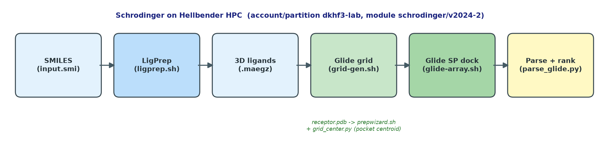
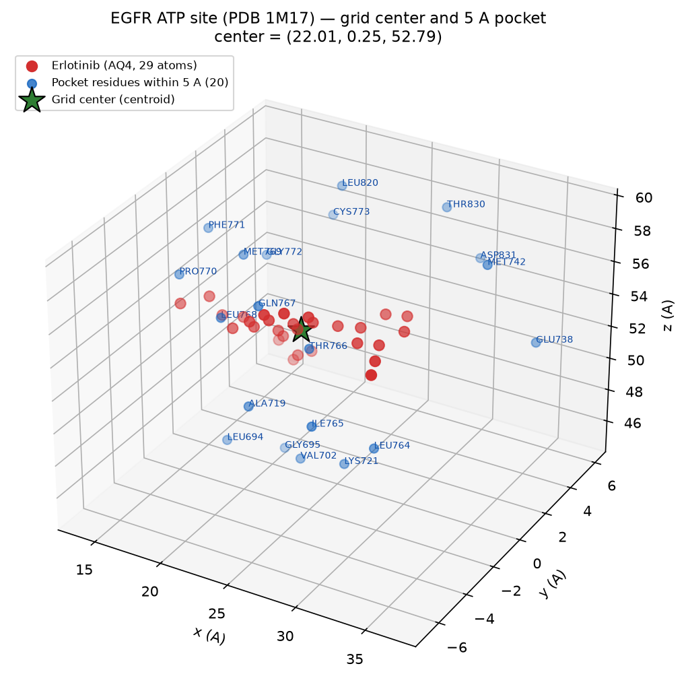

# schrodinger-hpc

**Running Schrödinger (Glide docking + LigPrep) at scale on an academic SLURM HPC cluster — with license-free Python tools for the prep and analysis around it.**

[](https://github.com/hentablihamza/schrodinger-hpc/actions/workflows/ci.yml)

This repository is a practical, production-style toolkit for doing structure-based virtual screening with Schrödinger on a shared high-performance computing cluster. It collects the real SLURM job scripts, the job-array pattern for ultra-large screens, and a set of small, well-tested Python helpers that do the license-free parts of the workflow (ligand and binding-pocket extraction, grid placement, result parsing, and array-job monitoring). The worked example follows the EGFR kinase with erlotinib (PDB 1M17).

The SLURM scripts use the **real values** from the University of Missouri **Hellbender** cluster — account and partition `dkhf3-lab`, module `schrodinger/v2024-2` — so they are copy-and-adapt ready, not toy templates.

---

## The problem this solves

Running licensed docking software like Schrödinger Glide *well* on a shared cluster is its own skill, separate from the chemistry:

- **The software is licensed and only on the cluster.** You can't `pip install` Glide. It lives behind a module system and a floating license, so everything has to run as scheduled batch jobs — and anything you want to test locally or in CI must be license-free.
- **Real screens are big.** Docking a few compounds is easy; docking hundreds of thousands to millions means splitting the library and scheduling it as a job array, with restartable chunks and sane concurrency limits, not one giant serial job.
- **The glue work is error-prone.** Pulling the right ligand out of a messy PDB, defining a grid box on the actual binding site, collecting scores from many output files, and knowing whether a 200-task array finished cleanly — all of that sits *around* Glide and is where runs quietly go wrong.

## What this repo provides

1. **Ready-to-adapt SLURM scripts** (`slurm/`) for the full pipeline: LigPrep, protein prep, grid generation, serial Glide, and a **job array for large-scale virtual screening** — with the real Hellbender account/partition/module baked in and clear placeholders for your own site.
2. **License-free Python tools** (`tools/`) — RDKit + Biopython — that do the prep and analysis without needing Schrödinger, so they run on any login node and are unit-tested in CI:
   - extract ligands from a PDB (handling many ligands, skipping waters/ions/buffers),
   - extract binding-pocket residues within a cutoff,
   - compute a grid center and box from the co-crystal ligand,
   - parse Glide result CSVs into ranked tables,
   - summarize SLURM array-job progress from `sacct`/`squeue` output.
3. **A real worked example** (`examples/egfr/`) on EGFR / erlotinib (PDB 1M17), with every output genuinely produced by the tools.

## Workflow



```
input.smi ──ligprep.sh──────────▶ ligands.maegz
receptor.pdb ──prepwizard.sh────▶ receptor_prepared.maegz
          + grid_center.py ──────▶ GRID_CENTER
                                       │
receptor_prepared + GRID_CENTER ──grid-gen.sh──▶ glide-grid_<target>.zip
ligands.maegz + grid ──glide-dock.sh / glide-array.sh──▶ poses (*_pv.maegz) + CSV
                                       │
                           parse_glide.py ──▶ ranked hits
```

## Quick start

```bash
# Create the license-free helper environment (no Schrödinger needed):
conda env create -f environment.yml
conda activate schrodinger-hpc
#   or:  pip install -r requirements.txt

# Reproduce the EGFR example (real outputs):
python examples/egfr/run_example.py

# Run the tests:
pytest
```

On the cluster, the Schrödinger steps are submitted as batch jobs:

```bash
sbatch slurm/ligprep.sh        # SMILES -> 3D ligands
sbatch slurm/prepwizard.sh     # protein preparation
sbatch slurm/grid-gen.sh       # build the Glide grid
sbatch slurm/glide-array.sh    # large-scale virtual screening (job array)
```

## The SLURM scripts

See [`slurm/README.md`](slurm/README.md) for the full table and submission/monitoring guide.

| Script | Purpose |
|---|---|
| `ligprep.sh` | 2D SMILES → 3D ligands (Epik ionization/tautomers) |
| `prepwizard.sh` | Protein Preparation Wizard |
| `grid-gen.sh` | Glide receptor grid on the binding site |
| `glide-dock.sh` | Serial Glide SP docking |
| `glide-array.sh` | **Job array** for ultra-large virtual screening |
| `longleaf-glide-gpu.sh` | Historical UNC Longleaf GPU variant (second cluster) |

**The headline large-scale pattern** — split a library into N chunks and dock them in parallel, concurrency-limited, restartable:

```bash
#SBATCH --array=0-199%40
CHUNK=$(printf "%03d" "${SLURM_ARRAY_TASK_ID}")
glide "chunk_${CHUNK}.in" -NOJOBID
```

## The Python tools

All in `tools/`, each importable and with a small CLI (license-free):

| Tool | Does |
|---|---|
| `extract_ligands.py` | Pull HETATM ligands from a PDB, skip waters/ions/buffers, save each separately |
| `extract_pocket.py` | Find binding-pocket residues within a cutoff of a ligand |
| `grid_center.py` | Compute grid center + inner/outer box from a ligand |
| `parse_glide.py` | Parse a Glide CSV export, best pose per ligand, ranked |
| `squeue_summary.py` | Summarize array-job progress from `sacct`/`squeue` text |

```bash
python tools/extract_ligands.py examples/egfr/1M17.pdb --list
python tools/extract_pocket.py examples/egfr/1M17.pdb --ligand-res AQ4 -c 5.0
python tools/grid_center.py examples/egfr/ligands/AQ4_A_999.pdb
```

## Worked example — EGFR (PDB 1M17)

Real outputs from `examples/egfr/run_example.py` (see [`examples/egfr/README.md`](examples/egfr/README.md)):

- **1 ligand extracted:** erlotinib (AQ4), 29 atoms (20 waters skipped)
- **20 pocket residues** within 5 Å — including the catalytic LYS721, gatekeeper THR766, hinge MET769, and DFG ASP831, i.e. the canonical EGFR ATP site
- **Grid center:** (22.014, 0.253, 52.794), ready to paste into `grid-gen.sh`



> The example Glide results CSV is **synthetic/illustrative** — Glide itself is licensed and cannot run in CI, so no docking scores are fabricated as real. Everything else (ligand, pocket, grid center) is computed from the actual structure.

## A note on licensing of the *software*

Schrödinger (Glide, LigPrep, PrepWizard) is **licensed commercial software** and is never bundled or run here — the SLURM scripts call it via `module load schrodinger/v2024-2` on the licensed cluster, and CI only exercises the open-source Python helpers. The crystal structure used in the example comes from the RCSB PDB (freely available; attribution in the example README).

## Acknowledgements

This work was made possible by the **University of Missouri Hellbender HPC cluster**, where I learned high-performance computing for computational drug discovery — from SLURM job arrays and module systems to scheduling licensed software across dedicated nodes. I am grateful to the staff and resources that make large-scale computational chemistry possible there.

I also warmly thank the **Kireev Lab** (PI: Dr. Dmitri Kireev) for providing the Schrödinger license and dedicated compute nodes that supported this docking and virtual-screening work. (Kireev is the lab/PI — the SLURM account and partition are `dkhf3-lab`.)

## Author

**Hamza Hentabli, Ph.D.** — AI/ML Drug Discovery & Cheminformatics Scientist

[Google Scholar](https://scholar.google.com/citations?user=-7dUlnMAAAAJ) · [ORCID 0000-0002-9530-2815](https://orcid.org/0000-0002-9530-2815)

### Related repositories

- [docking-made-easy](https://github.com/hentablihamza/docking-made-easy) — reproducible AutoDock Vina docking
- [fingerprint-similarity-guide](https://github.com/hentablihamza/fingerprint-similarity-guide) — benchmark-backed fingerprint & similarity guide
- [chembl-easy](https://github.com/hentablihamza/chembl-easy) — clean, ML-ready ChEMBL bioactivity data
- [practical-cheminformatics-course](https://github.com/hentablihamza/practical-cheminformatics-course) — 12-notebook RDKit/QSAR course
- [practical-biopython-course](https://github.com/hentablihamza/practical-biopython-course) — 12-notebook Biopython course
- [practical-molecular-dynamics-course](https://github.com/hentablihamza/practical-molecular-dynamics-course) — 12-notebook MD course with OpenMM
- [qsar-split-bench](https://github.com/hentablihamza/qsar-split-bench) — benchmarking data splits for QSAR

---

*Data attribution: PDB 1M17 from the RCSB Protein Data Bank. Schrödinger is a trademark of Schrödinger, Inc.; this repository is an independent collection of job scripts and helper tools and is not affiliated with or endorsed by Schrödinger, Inc.*
